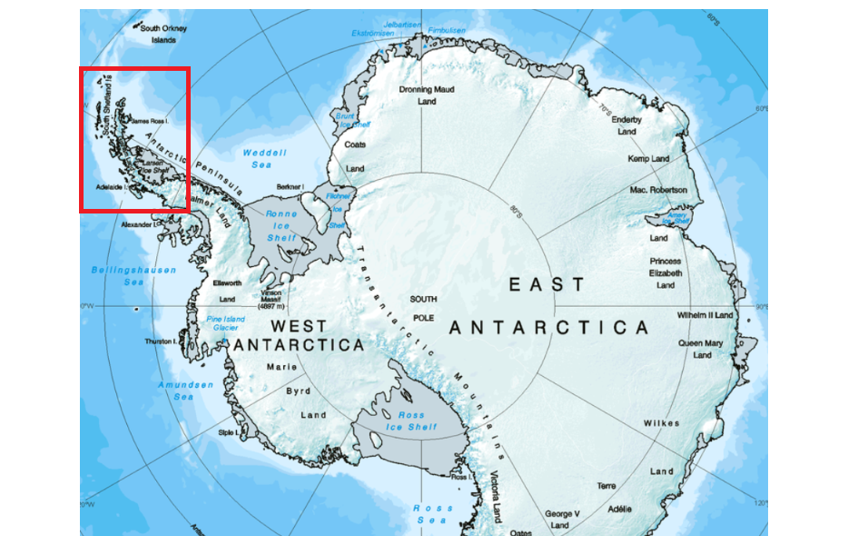
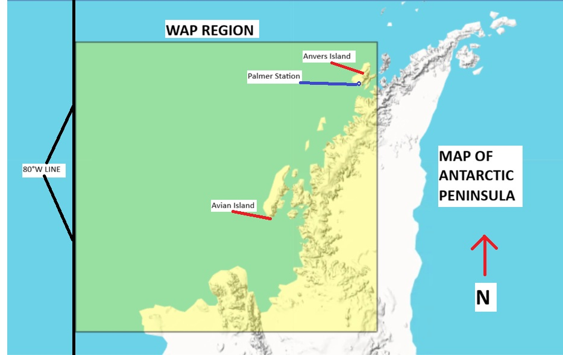

```{r setup, include=FALSE, echo=FALSE}
knitr::opts_chunk$set(echo = TRUE)
options(scipen = 999)
library(lubridate)
library(tidyverse)
```

## ABSTRACT

The purpose of this analysis is to determine what are the measurable impacts of climate change on both air and sea temperatures recorded on the Western Antarctic Peninsula (WAP), and compare these air/ocean temperature changes to sea ice levels. This will determine if there is any relationship between climate change and Antarctic sea ice levels, quantify how much one variable has changed since the 1970s, and how a chosen variable it impacting another by visualizing the trend. This study found that air temperatures have increased 10x as much since the 1970s compared to Antarctic ocean temperatures, however both have increased steadily due to anthropogenic greenhouse gas emissions. These small temperatures changes have led to a loss of sea ice concentration in some areas by as much as \~70%, and \~80,000 km² of sea ice has been lost over the same time interval for the entire WAP region. This study has confirmed a strong, widespread, and negative relationship between sea ice levels and temperature changes. With these changes quantified, further analysis will likely move to examine how a native animal population (such as Adélie penguins) is impacted by these environmental changes, potentially including population predictions and/or weather predictions.

## INTRODUCTION

The topic of climate change is not new, and has been reported on for many years via popular media outlets. It has become an increasingly concerning topic, especially in regions such as the Arctic Circle, where reports of drastic sea ice loss and shrinking habitats are affecting both the survival of polar/marine animals, and compounding the global greenhouse effect. However, the effects of anthropogenic greenhouse gas emissions are less explored (and reported on) for the planet's opposite frozen pole, Antarctica, which will be the focus of this study. Sea ice is formed in polar regions around the world, and it is frozen seawater that creates a layer on top of the ocean. It plays a crucial role in managing and regulating the temperature of the ocean, has a cooling effect on the atmosphere, as well as giving a habitat for the animals living there. However, the changing temperatures is expected to make it even more difficult for sea ice cover to remain throughout the year, and so it is important to understand and evaluate these everlasting effects of climate change. This study expects that as in the Northern Arctic, the Southern Antarctic should experience drastic effects of increasing sea/air temperatures that affect the region’s sea ice coverage.

The central question motivating this analysis is: Are increasing temperatures due to climate change affecting sea ice coverage near Palmer Station, Antarctica? This study aims to visualize the relationship between sea ice and changing air/ocean temperatures over several decades. This project uses data sets of both the past weather patterns and sea ice to determine any correlations and patterns, first plotting how climate change is impacting temperatures, and relating this data to sea ice values over time. Throughout our research, we compare sea ice concentration and area across multiple different subregions of the Antarctic Peninsula to see how they can differ locally. 

Our research is beneficial to climate scientists and ecologists who study climate change and Antarctic ecosystems. With the results of our analysis, this study will further explore the common hypothesis that there is a relationship between temperatures and sea ice, as increasing temperatures are likely correlated with the reduction of sea ice concentration and coverage in Antarctica. To further our understanding and analysis, we will use different types of data visualizations to help us reach a conclusion for this hypothesis and analyze the observed trends. The main motivation is to probe the data sets, find correlations, and understand the effects that climate change has on this polar region. 

## EXECUTIVE SUMMARY

- This study has found that air temperatures in Antarctica have increased by \~1°C since the 1970s, while ocean temperatures have also increased by \~0.1°C over the same time frame.

- This study finds that the effects of these increased ocean and air temperatures has led to a decrease in sea ice concentration in some areas by as much as \~70%, while sea ice area for the entire Western Antarctic Peninsula region has dropped by \~80,000 km² since the 1970s.

- This study confirms that there is a negative relationship between sea ice level and both ocean and air temperatures over the measured time. As ocean and air temperatures continued to rise since the 1970s, sea ice levels have dropped to record-lows in the surveyed regions, and climate change's effects appear to be widespread in different parts of the Antarctic Peninsula.

- The Arctic (North Pole) is experiencing a greater impact of sea ice loss than the less-discussed Antarctic (South Pole), however both regions are experiencing record-high temperatures and record-low sea ice that is changing Earth's poles faster than at any point in human history.

## DATA DESCRIPTION

Investigating this question first requires a baseline understanding of how much air and ocean temperatures have changed on average in the Antarctic, due to increasing greenhouse gas concentrations in the atmosphere. It also requires an understanding of historical and current sea ice concentrations, sea ice area, and surveying several Antarctic sites to determine whether the effects of climate change are widespread or localized on the continent. The data chosen to consider these factors is taken from an NSF LTER (Long Term Ecological Research) site located on Anvers Island, directly off the western coast of the mainland Antarctic Peninsula, known as Palmer Station Antarctica LTER. Scientists at this site have been collecting weather data and sea ice changes for more than 40 years throughout the Western Antarctic Peninsular region, and per NSF requirements, all data collected must be routinely updated and published online freely through the Environmental Data Initiative (EDI) portal. Only an account with EDI is required to examine Palmer Station's data set information, collection information, and download the ".csv" files of various data tables. The citations and links to the data sets used for this preliminary report are included below, as all come from Palmer Station's EDI portal site:

1.  Palmer Station Antarctica LTER and S. Stammerjohn. 2024. Average monthly sea ice coverage for various PAL LTER sub-regions West of the Antarctic Peninsula derived from passive microwave satellite data, 1978 - June 2024. ver 9. Environmental Data Initiative. <https://doi.org/10.6073/pasta/ffbd9858508624cb8bf2b7bd0eca3e0c> (Accessed 2026-10-02).
2.  Palmer Station Antarctica LTER. 2024. Monthly weather averages for Palmer Station, Antarctica (1974-2024) ver 10. Environmental Data Initiative. <https://doi.org/10.6073/pasta/499f9fe0ac882f41c7b92e465a31291c> (Accessed 2026-10-02).

For the purposes of this preliminary analysis, this study will first consider the variables (from Monthly_Weather_Clean.csv) of monthly date tied with that month's mean temperature (°C) and mean sea surface temperature (°C) for every month from 1979 to 2023, or in some visualizations from late 1978 to early 2024. This leaves 540 total monthly weather observations from Palmer Station itself, from Jan 1979 to Dec 2023, or in some visualizations, 564 observations that include 12 extra months of data from Jan 1978 to Dec 2024, despite only late months in 1978 and early months in 2024 having data. In terms of the other two data sets (SeaIceArea_Clean.csv & SeaIceConc_Clean.csv) the variables this study considers is the year/monthly sea ice area (km²) and mean sea ice concentration (%) for the entire WAP region (sea ice area values only), Anvers, and Avian Islands (both islands used for sea ice concentration values) off the coast of the Peninsula. The WAP region below includes 540 area values for 540 months between January 1979 to December 2023, with the Anvers and Avian Islands including 564 observations per region to include 1978 and 2024. It is important to note that the entire designated WAP region is \~400,000 km² in size, and so all values calculated are relative to that value. It is also important to note that sea ice concentrations are measured in an area that is 200 X 200 km that surrounds the islands, to give context to the numbers described below. The maps below include the regions examined in this preliminary analysis, and what the study considers the entire WAP region, where sea ice area of this region was measured. The LTER station itself and other small islands are also included in Figure 2.



Figure 1: Map of Antarctica, with red box designating the peninsula region shown in Figure 2.

{width="630"}

Figure 2: Map of Antarctic Peninsula, with Western Antarctic Peninsula (WAP) region highlighted in yellow. When referring to the WAP region in the text, it is referring to the whole area in yellow.

The data set was prepared before being put into the repository by first replacing all of the -999 spaces with NA spaces, and changing the column names to shorter names with underscores instead of spaces, all being done in the .csv Excel files in order to be more friendly to R when loaded in. The names of the .csv files were also changed to show they were cleaned for R subsetting. Data was further cleaned for analysis by combining the year and month columns of SeaIceArea_Clean.csv and SeaIceConc_Clean.csv each into a single "Date" column like the weather data has (m/d/y), which allowed for a proper date column to be formatted and further allowed a subset by date to occur. Once the chosen dates were properly formatted and isolated, the desired regions and variables of those regions were isolated further. This was done in order to determine the visual relationships between a region's chosen variables, Palmer Station's weather data, or against time itself; each relationship is explained under each graph, and each author took subsets of different regions and variables from the data sets, further explained in the repository. Anvers Island was used frequently in the visualizations since it is the closest region to the actual Palmer Station weather instruments, and so was expected to give the most accurate temps-to-sea ice comparisons. The basic summaries of all variables and regions considered in this analysis are recorded below, along with the total number of observations per variable included in the cleaned data sets.

**Mean Air Temperature Data Summary (in °C) and \# of Obs. at Palmer Station, Antarctica:**

```{r, echo = FALSE}
#First, all cleaned datasets must be read into the global environment:
weather <- read.csv("Monthly_Weather_Clean.csv")
seaicearea <- read.csv("SeaIceArea_Clean.csv")
seaiceconc <- read.csv("SeaIceConc_Clean.csv")

summary(weather$Mean_Temperature_C)
length(weather$Mean_Temperature_C)
```

**Mean Sea Surface Temperature Summary (in °C) and \# of Obs. at Palmer Station, Antarctica:**

```{r, echo=FALSE}
summary(weather$Mean_Sea_Surface_Temperature_C)
length(weather$Mean_Sea_Surface_Temperature_C)
```

**Sea Ice Area Data Summary and \# of Obs. For Total WAP Region, in km²:**

```{r, echo=FALSE}
for_sum <- seaicearea[seaicearea$Subregion == "WAP", ]
summary(for_sum$Sea_ice_area)
length(for_sum$Sea_ice_area)
```

**Sea Ice Concentration Summary and \# of Obs. for both Anv and Avi Islands, in %:**

```{r, echo=FALSE}
another_sum <- seaiceconc[seaiceconc$Subregion %in% c("Anv", "Avi"), ]
summary(another_sum$Mean_sea_ice_conc)
length(another_sum$Mean_sea_ice_conc)
```

## VISUALIZATIONS/ANALYSIS

### Figures 3 and 4 Analysis:

Figure 3 below includes the monthly air temperatures at Palmer Station from 1979 to 2023, along with a linear regression trend line (black) between the two variables. By using the linear model to fit a trend line to the temperature data over time (further described in the GitHub Repository .RMD file for this graph), the slope of the trend line is +0.00006461468, indicating temperatures are slowly increasing on average over the time surveyed. The "fitted.values" section of the linear model also gives the actual points of the trend line, with the difference between the first and last value of the model being +1.06°C, meaning that on average over the time surveyed, temperatures have increased by 1.06°C. This was expected, as it's estimated the Arctic Circle has warmed \~2.80°C since the 1970s, and so this data highlights that the Antarctic is not warming as fast as the North Pole, but still a considerable amount in the time analyzed.

Figure 4 below includes the monthly sea ice area for the entire WAP region from 1979 to 2023, along with a linear regression trend line (black) between the two variables. By using this new linear model to fit a trend line to the area data over time (further described in the GitHub Repository .RMD file for this graph), it appears that the slope of the trend line is -4.812, indicating a negative relationship between time and the amount of sea ice in the WAP region. Furthermore, by subracting the last and first value of the trend line as in Figure 3, we can see the average amount of sea ice area has decreased by -78,942.70 km² over the years surveyed. This suggests that the WAP region alone has lost an area of sea ice that is roughly the size of Panama over the decades surveyed. These figures highlight the incredible effects of greenhouse gas concentrations on polar sea ice levels, as a \~1°C increase in temperatures can results in thousands of kilometers of sea ice melted into the ocean.

```{r, echo=FALSE}
##Then, we need to subset the data for mean temperatures for all years from 1979 to 2023, as these are the full years that we have data for (not parts of years):

weather_subset <- weather[, c("Date", "Mean_Temperature_C")]

weather_subset$Date = as.Date(weather_subset$Date, format = "%m/%d/%Y")

weathergooddates <- weather_subset[weather_subset$Date >= as.Date("1979-01-01") & weather_subset$Date <= as.Date("2023-12-01"), ]


weathergooddates <- weather_subset[
  weather_subset$Date >= as.Date("1979-01-01") &
    weather_subset$Date <= as.Date("2023-12-01"),]

##Now, we need to do the same thing with the Sea Ice Area data, getting 1979 to 2023 area values for sea ice area for a specific region, here WAP:

seaicearea$Date <- paste(seaicearea$Month, rep("01", length.out = 2256),
                         seaicearea$Year, sep = "-")

seaicearea <- seaicearea %>% dplyr::mutate(Date2 = lubridate::mdy(Date))

seaicearea_fixed <- seaicearea[seaicearea$Date2 >= as.Date("1979-01-01") & seaicearea$Date2 <= as.Date("2023-12-01"), ]

seaicearea_WAP <- seaicearea_fixed[seaicearea_fixed$Subregion == "WAP", ]

seaicearea_subsetWAP <- seaicearea_WAP[, c("Date2", "Sea_ice_area")]


##At this point, we end with the objects of weathergooddates and seaicearea_subsetWAP, both of which have 540 variables for all months of 1979 and 2023. Because the entries already line up in both datasets, such as the second entry in both datasets corresponding to February 1979, I can now graph the 540 temp values in weathergooddates versus the years, and the 540 area values in seaicearea_WAPdates versus years and do trendlines separately:


##Now we should be ready to plot!
plot(weathergooddates$Date, weathergooddates$Mean_Temperature_C,
     type = "l",
     xlab = "Monthly Measurements from 1979-2023",
     ylab = "Monthly Mean Temperatures at Palmer Station (°C)",
     main = "Monthly Mean Temperatures at Palmer Station, 1979-2023",
     col = "red")

abline(lm(weathergooddates$Mean_Temperature_C ~ weathergooddates$Date), col = "black", lwd = 2)

##------------------------------------------------------

plot(seaicearea_subsetWAP$Date2, seaicearea_subsetWAP$Sea_ice_area,
     type = "l",
     xlab = "Monthly Measurements from 1979-2023",
     ylab = "Monthly Sea Ice Area for WAP Region (km²)",
     main = "Monthly Sea Ice Area for WAP Region, 1979-2023",
     col = "blue")

abline(lm(seaicearea_subsetWAP$Sea_ice_area ~ seaicearea_subsetWAP$Date2), col = "black", lwd = 2)

WAPareamodel <- lm(seaicearea_subsetWAP$Sea_ice_area
                   ~ seaicearea_subsetWAP$Date2)
```

### Figure 5 Analysis: 

Figure 5 below compares yearly average sea ice concentration in two Antarctic subregions, Anver's Island and Avian Island, from 1979 to 2023. The purpose of this analysis is to look at two distant areas of the WAP region (200 X 200 km areas around each island), and determine if the sea ice loss trends appear to be localized or widespread across the Peninsula. The blue line in the graph indicates Avian Island's area, while the red line indicates Anver's Island. It is expected that the blue line would be above the red line in the graph since Avian Island is more southerly than Anvers Island, however there is a clear decrease in sea ice concentration over time and both islands appear to follow the same trends annually. Because both of these lines are almost exactly in sync in terms of rising and falling, this suggests that the effects of climate change in the WAP region are widespread, but the effect is lessened on areas closer to the true geographical South Pole (Avian Island). Concentrations of ice drop to less than 20% in recent years for the areas surveyed.

```{r, echo=FALSE}
sea_ice_data <- read.csv("SeaIceConc_Clean.csv")
sea_ice_data <- subset(sea_ice_data, Subregion %in% c("Anv", "Avi"))
sea_ice_annual <- with(sea_ice_data,
                       tapply(Mean_sea_ice_conc,
                              list(Year, Subregion),
                              mean, na.rm = TRUE)
)
years <- as.numeric(rownames(sea_ice_annual))

plot(years, sea_ice_annual[, "Anv"],
     type = "l",
     col = "red",
     xlab = "Monthly Measurements from 1979-2023",
     ylab = "Annual Mean Sea Ice Concentration (%)",
     main = "Sea Ice Concentration vs. Time",
     ylim = c(0, 100))

lines(years, sea_ice_annual[, "Avi"],
      col = "blue")
```

### Figure 6, 7, and 8 Analysis: 

Figure 6 below analyzes the monthly ocean temperatures at Palmer Station vs. Time, again including a linear regression trend line to highlight the relationship between the variables. Using the same "fitted.values" approach for the linear regression, the difference between the first and last value in the fitted line is +0.10°C, indicating that sea surface temperatures have not increased as quickly over the time measured compared to air temperatures at Palmer Station. Sea surface temperatures have increased over the analyzed time, however slightly, due to increasing climate change.

Figure 7 below analyzes the relationship between sea surface temperatures and the total sea ice area measured for the WAP region for all months designated in the subtitle of the plot. This graph highlights the strong negative correlation between sea surface temperature and changes in sea ice, as months that had colder ocean temps also had the highest measured sea ice area for the WAP region. Months that had warmer recorded sea temperatures consequently had the lowest monthly sea ice areas on record. Both air and ocean temperatures have a negative effect on sea ice area, with many overlapping dots recording sea ice area as less than 20,000 km².

Figure 8 below analyzes the relationship between sea surface temperatures and sea ice concentration for Anvers Island (200 X 200 km area) for all months designated in the subtitle of the plot. As in actual recorded sea ice area (km²), sea ice concentration also has a strong negative relationship with sea surface temperatures. Sea ice concentration only goes down with increasing sea surface temperatures, indicating the strong effect ocean and air temperatures have on changing ice concentrations in Antarctica. As in the previous figures, extremely low sea ice concentrations are recorded as ocean temperatures increase, and the broad distribution of values indicates seasonality is not a factor, as we would expect seasonality to keep the values in a rising/falling region of the graph, not start so high and drop to record low numbers.

```{r, echo=FALSE}
weatherClean <- data.frame(
  Date = as.Date(weather$Date, format = "%m/%d/%Y"),
  surfaceTemp = weather$Mean_Temperature_C,
  MseaSurfaceTemp = weather$Mean_Sea_Surface_Temperature_C)

areaFiltered <- subset(seaicearea, Subregion == "WAP")
SSIclean <- data.frame(
  Date = as.Date(paste(areaFiltered$Year, areaFiltered$Month, "01", sep = "-"),
                 format = "%Y-%m-%d"),
  SIA = areaFiltered$Sea_ice_area)

SSIfiltered <- subset(seaiceconc, Subregion == "Anv")
SIAfiltered <- data.frame(
  Date = as.Date(paste(SSIfiltered$Year, SSIfiltered$Month, "01", sep = "-"),
                 format = "%Y-%m-%d"),
  SIA = SSIfiltered$Mean_sea_ice_conc)
projectData <- weatherClean
projectData$SIA <- as.numeric(
  SSIclean$SIA[match(weatherClean$Date, SSIclean$Date)])
projectData$SIA <- as.numeric(
  SIAfiltered$SIA[match(weatherClean$Date, SIAfiltered$Date)])

##Helper functions for plotting:

TITLEADDER <- function(title, subtitle) {
  title(main = title, adj = 0, line = 2.2, cex.main = 1.2)
  mtext(subtitle, side = 3, adj = 0, line = 0.8, cex = 0.9, col = "grey30")
}
TRENDLINEADDER <- function(model, x) {
  xs <- seq(min(x), max(x), length.out = 200)
  newd <- data.frame(xs)
  names(newd) <- names(model$model)[2]
  pr <- predict(model, newdata = newd, interval = "confidence")
  polygon(c(xs, rev(xs)), c(pr[, "lwr"], rev(pr[, "upr"])),
          col = adjustcolor("grey50", alpha.f = 0.3), border = NA)
  lines(xs, pr[, "fit"], col = "black", lwd = 2)
}

##Graph 1: Mean Sea Surface Temperature at Palmer Station (SST) vs. Time


SSTdata <- subset(projectData, !is.na(Date) & !is.na(MseaSurfaceTemp))
TIMEdata <- lm(MseaSurfaceTemp ~ Date, data = SSTdata)

par(mar = c(4.5, 4.5, 5, 1))
plot(SSTdata$Date, SSTdata$MseaSurfaceTemp, type = "l",
     col = "darkcyan", lwd = 1.2,
     xlab = "Year", ylab = "Mean Sea Surface Temperature (°C)")
abline(TIMEdata, col = "black", lty = 2, lwd = 2)
TITLEADDER("Monthly Mean Sea Surface Temperature at Palmer vs. Time", "1978-11-01 to 2024-04-01")

##Graph 2: Surface Temperature (Palmer) vs. Sea Ice Area (WAP)

TEMPdata <- subset(projectData, !is.na(surfaceTemp) & !is.na(SIA))
TEMPmod <- lm(surfaceTemp ~ SIA, data = TEMPdata)


par(mar = c(4.5, 4.5, 5, 1))
plot(TEMPdata$SIA, TEMPdata$surfaceTemp, type = "n",
     xlab = "Monthly Sea Ice Area (km²)",
     ylab = "Monthly Mean Surface Temperature (°C)")
points(TEMPdata$SIA, TEMPdata$surfaceTemp, pch = 16, col = adjustcolor("purple", alpha.f = 0.6))
TRENDLINEADDER(TEMPmod,TEMPdata$SIA)
TITLEADDER("Sea Surface Temp vs. Sea Ice of WAP Region","1978-11-01 to 2024-04-01")

##Graph 3: Surface Temperature vs. Sea Ice Concentration (Anvers Island)

CONCdata <- subset(projectData, !is.na(surfaceTemp) & !is.na(SIA))
CONCmod <- lm(surfaceTemp ~ SIA, data = CONCdata)

par(mar = c(4.5, 4.5, 5, 1))
plot(CONCdata$SIA, CONCdata$surfaceTemp, type = "n",
     xlab = "Mean Sea Ice Concentration (%)",
     ylab = "Monthly Mean Surface Temperature (°C)")
points(CONCdata$SIA, CONCdata$surfaceTemp,pch = 16, col = adjustcolor("purple", alpha.f = 0.6))
TRENDLINEADDER(CONCmod,CONCdata$SIA)
TITLEADDER("Sea Surface Temp vs. Sea Ice Concentration (Anvers Island)", "1978-11-01 to 2024-04-01")
```

Together, these six visualizations highlight that air and ocean temperatures have been increasing measurably over the analyzed time due to anthropogenic greenhouse gas release, and these increases have a substantial effect on the sea ice area and concentration for the WAP region. It appears that sea ice concentrations for parts of the region have dropped to their lowest recorded levels (less than 10-20% in some cases) and sea ice loss in the region is akin to roughly the size of Panama. Seasonality is strong in Antarctica due to \~6 months of light and \~6 months of darkness out of the year due to its position on the Earth, however, as the linear models show, seasonality is not the explanation for these changes, as sea ice levels are hitting record low levels instead of fluctuating with the season each year; instead, an overall decrease each year is observed.

## FUTURE ANALYSIS

Based on the data and conclusions drawn from these initial graphs, this study finds there is a significant correlation between sea ice levels and air/sea surface temperature. Our plan for future analysis is informed by this conclusion, and is as follows: We are now interested in incorporating more data sets taken from the Palmer Station LTER website that contains information on the population and breeding habits of the native Adélie penguin (*Pygoscelis adeliae*), or observational studies of marine mammals or seabirds in the area. We plan to compare and contrast local animal data with weather and sea ice characteristics, in order to determine if there are any measurable impacts of sea ice loss on the native animals on the Antarctic Peninsula/Southern Ocean. Specifically, further studies will investigate if it affects the overall year-to-year population and if it affects breeding characteristics, activity patterns, foraging habits, breeding success rates and/or young-rearing habits. We will use multi-characteristic graphs and total dataset information in order to evaluate the relationship between a selected animal population's ecological habits and temperature/sea ice on the Antarctic peninsula, to determine what effects the changing environment is having on species survival.

It should be noted that the working hypothesis is that animal populations (their birth success rates, activity patterns, foraging habits, etc.) should be negatively correlated with increasing sea surface temps, air temperature, and time, and positively correlated with increasing sea-ice area and concentration. This is based on our understanding that the ecosystem of the area is dependent on sub-zero temperatures to maintain their sea-ice habitat area and prey populations. A possible further progression of this analysis is a machine learning model designed and trained to predict future penguin data based on projected weather patterns, but this is dependent on if the study has available time and the technical ability to do this within RStudio.

## CONTRIBUTIONS OF AUTHORS

**Jack Donnelley:**

- Mean Sea Surface Temp vs. Time Graph (Fig. 6)

- Surface Temp vs Sea Ice Area (WAP)/Concentration (Anvers Island) Graphs (Fig. 7, 8)

- Future Work Section of Report

**Selina Syed:**

- Sea Ice Concentration vs. Time Graph in 2 Island Regions (Fig. 5)

- Introduction Section of Report

**Wesley Cross:**

- Abstract, Executive Summary, Data Description Sections of Report

- Mean Air Temperatures vs. Time at Palmer Station Graph (Fig. 3)

- Mean Sea Ice Area for Entire WAP Region vs. Time Graph (Fig. 4)

## GITHUB REPOSITORY LINK

<https://github.com/WesleyC11/AntarcticaProject_STATS107>

A special thanks to Dr. Sánchez Gómez and Nathalie Jones for helping to brainstorm potential projects and R code that was used in this analysis project, along with the NSF-funded LTER Network and researchers that helped collect and compile Antarctic data for our public use.

{width="199"}
