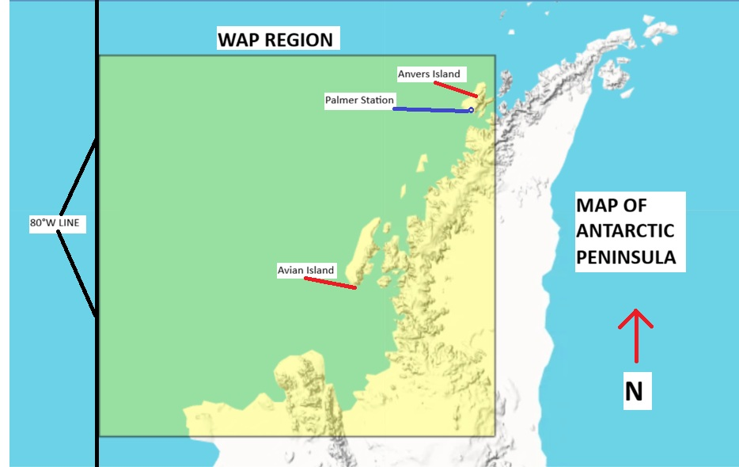

```{r setup, include=FALSE}
knitr::opts_chunk$set(echo = TRUE)
options(scipen = 999)
library(lubridate)
library(tidyverse)
```

**Note to myself: Update the README of all files and don't forget to put PDF of final report in the repository before submission!**

## Data Description Section for Report

Investigating this question first requires a baseline understanding of how much air and ocean temperatures have changed on average in the Antarctic, due to increasing greenhouse gas concentrations in the atmosphere. It also requires an understanding of historical and current sea ice concentrations, sea ice area, and surveying several Antarctic sites to determine whether the effects of climate change are likely widespread or localized on the continent. The data chosen to consider these factors is taken from an NSF LTER (Long Term Ecological Research) site located on Anvers Island, directly off the western coast of the mainland Antarctic Peninsula, known as Palmer Station Antarctica LTER. Scientists at this site have been collecting weather data and sea ice changes for more than 40 years throughout the Western Antarctic Peninsular region, and per NSF requirements, all data collected must be routinely updated and published online freely through the Environmental Data Initiative (EDI) portal. Only an account with EDI is required to examine Palmer Station's data set information, collection information, and download the ".csv" files of various data tables. The citations and links to the data sets used for this preliminary report are included below, as all come from Palmer Station's EDI portal site:

1.  Palmer Station Antarctica LTER and S. Stammerjohn. 2024. Average monthly sea ice coverage for various PAL LTER sub-regions West of the Antarctic Peninsula derived from passive microwave satellite data, 1978 - June 2024. ver 9. Environmental Data Initiative. <https://doi.org/10.6073/pasta/ffbd9858508624cb8bf2b7bd0eca3e0c> (Accessed 2026-10-02).
2.  Palmer Station Antarctica LTER. 2024. Monthly weather averages for Palmer Station, Antarctica (1974-2024) ver 10. Environmental Data Initiative. <https://doi.org/10.6073/pasta/499f9fe0ac882f41c7b92e465a31291c> (Accessed 2026-10-02).

For the purposes of this preliminary analysis, this study will first consider the variables (from Monthly_Weather_Clean.csv) of monthly date tied with that month's mean temperature (°C) and mean sea surface temperature (°C) for every month from 1979 to 2023, or in some visualizations from late 1978 to early 2024. This leaves 540 total monthly weather observations from Palmer Station itself, from Jan 1979 to Dec 2023, or in some visualizations, 564 observations that include 12 extra months of data from Jan 1978 to Dec 2024, despite only late months in 1978 and early months in 2024 having data. In terms of the other two data sets (SeaIceArea_Clean.csv & SeaIceConc_Clean.csv) the variables this study considers is the year/monthly sea ice area (km²) and mean sea ice concentration (%) for the entire studied West Antarctic Peninsula region (WAP), Anvers and Avian Islands regions off the coast of the WAP, and (**JACK'S GRAPHS HAVE NO LABEL)**. The WAP region below includes 540 area values for 540 months between January 1979 to December 2023, with the Anvers, Avian, and **JACK REGION** Islands including 564 observations per region to include 1978 and 2024. The map below includes the regions examined in this preliminary analysis, and what the study considers the entire WAP region where sea ice area of this region was measured. The LTER station itself and other small island are also included.

{width="660"}

Figure 1: Map of Antarctic Peninsula, with Western Antarctic Peninsula highlighted in yellow.

The data set was prepared before being put into the repository by first replacing all of the -999 spaces with NA spaces, and changing the column names to shorter names with underscores instead of spaces, all being done in the .csv Excel files in order to be more friendly to R when loaded in. The names of the .csv files were also changed to show they were cleaned for R subsetting. Data was further cleaned for analysis by combining the year and month columns of SeaIceArea_Clean.csv and SeaIceConc_Clean.csv each into a single "Date" column like the weather data has (m/d/y), which allowed for a proper date column to be formatted and further allowed a subset by date to occur. Once the chosen dates were properly formatted and isolated, the desired regions and variables of those regions were isolated further. This was done in order to determine the visual relationships between a region's chosen variables, Palmer Station's weather data, or against time itself; each relationship is explained under each graph. The following code chunk is included to view the basic summaries of all variables considered in this analysis.

```{r, echo = TRUE}
##First, the cleaned .csv files are read into the global environment:
weather <- read.csv("Monthly_Weather_Clean.csv")
seaicearea <- read.csv("SeaIceArea_Clean.csv")
seaiceconc <- read.csv("SeaIceConc_Clean.csv")

##Practice code for making the visualizations/obs. tables for this section:
##Air temperature 
summary(weather$Mean_Temperature_C)
length(weather$Mean_Temperature_C)

##Mean Sea Surface Temperature Summary (in °C) and # of Obs. at Palmer Station, Antarctica:
summary(weather$Mean_Sea_Surface_Temperature_C)
length(weather$Mean_Sea_Surface_Temperature_C)

##Sea Ice Area Data Summary and # of Obs. For Total WAP Region, in km²:

for_sum <- seaicearea[seaicearea$Subregion == "WAP", ]
summary(for_sum$Sea_ice_area)
length(for_sum$Sea_ice_area)

##Sea Ice Concentration Summary and # of Obs. for both Anv and Avi Islands 

another_sum <- seaiceconc[seaiceconc$Subregion %in% c("Anv", "Avi"), ]
summary(another_sum$Mean_sea_ice_conc)
length(another_sum$Mean_sea_ice_conc)
```

## Making of WAP Sea Ice Area and Avg. Temps Plots:

```{r}
##First, the cleaned .csv files are read into the global environment:
weather <- read.csv("Monthly_Weather_Clean.csv")
seaicearea <- read.csv("SeaIceArea_Clean.csv")
seaiceconc <- read.csv("SeaIceConc_Clean.csv")

##Next, we need to determine what variables/observations we will work with:
summary(weather)
summary(seaicearea)
summary(seaiceconc)


##Then, we need to subset the data for mean temperatures for all years from 1979 to 2023, as these are the full years that we have data for (not parts of years):

weather_subset <- weather[, c("Date", "Mean_Temperature_C")]
View(weather_subset)

weather_subset$Date = as.Date(weather_subset$Date, format = "%m/%d/%Y")

weathergooddates <- weather_subset[weather_subset$Date >= as.Date("1979-01-01") & weather_subset$Date <= as.Date("2023-12-01"), ]


weathergooddates <- weather_subset[
  weather_subset$Date >= as.Date("1979-01-01") &
    weather_subset$Date <= as.Date("2023-12-01"),]

View(weathergooddates)


##Now, we need to do the same thing with the Sea Ice Area data, getting 1979 to 2023 area values for sea ice area for a specific region, here WAP:

seaicearea$Date <- paste(seaicearea$Month, rep("01", length.out = 2256),
                         seaicearea$Year, sep = "-")

seaicearea <- seaicearea %>% dplyr::mutate(Date2 = lubridate::mdy(Date))

seaicearea_fixed <- seaicearea[seaicearea$Date2 >= as.Date("1979-01-01") & seaicearea$Date2 <= as.Date("2023-12-01"), ]

View(seaicearea_fixed)

seaicearea_WAP <- seaicearea_fixed[seaicearea_fixed$Subregion == "WAP", ]
View(seaicearea_WAP)

seaicearea_subsetWAP <- seaicearea_WAP[, c("Date2", "Sea_ice_area")]

View(seaicearea_subsetWAP)


##At this point, we end with the objects of weathergooddates and seaicearea_subsetWAP, both of which have 540 variables for all months of 1979 and 2023. Because the entries already line up in both datasets, such as the second entry in both datasets corresponding to February 1979, I can now graph the 540 temp values in weathergooddates versus the years, and the 540 area values in seaicearea_WAPdates versus years and do trendlines separately:


##Now we should be ready to plot!
plot(weathergooddates$Date, weathergooddates$Mean_Temperature_C,
     type = "l",
     xlab = "Monthly Measurements from 1979-2023",
     ylab = "Monthly Mean Temperatures at Palmer Station (°C)",
     main = "Monthly Mean Temperatures at Palmer Station, 1979-2023",
     col = "red")

abline(lm(weathergooddates$Mean_Temperature_C ~ weathergooddates$Date), col = "black", lwd = 2)

weathermodel <- lm(weathergooddates$Mean_Temperature_C ~ weathergooddates$Date)
weathermodel$fitted.values
weathermodel$coefficients
length(weathermodel$fitted.values)
weathermodel$fitted.values[526] - weathermodel$fitted.values[1]

## Looks like by using the linear model to fit a trendline to the temperature data over time, the slope of the trendline is positive, indicating temperatures are increasing on average over the time surveyed. The fitted.values seciton of the linear model gives the values of the trendline, with the difference between the first and last value of the model being positive 1.06°C, meaning that on average over the time surveyed, temperatures have increased by 1.06°C. 


##------------------------------------------------------


plot(seaicearea_subsetWAP$Date2, seaicearea_subsetWAP$Sea_ice_area,
     type = "l",
     xlab = "Monthly Measurements from 1979-2023",
     ylab = "Monthly Sea Ice Area for WAP Region (km²)",
     main = "Monthly Sea Ice Area for WAP Region, 1979-2023",
     col = "blue")

abline(lm(seaicearea_subsetWAP$Sea_ice_area ~ seaicearea_subsetWAP$Date2), col = "black", lwd = 2)

WAPareamodel <- lm(seaicearea_subsetWAP$Sea_ice_area
                   ~ seaicearea_subsetWAP$Date2)

WAPareamodel$coefficients
WAPareamodel$fitted.values
length(WAPareamodel$fitted.values)
WAPareamodel$fitted.values[538] - WAPareamodel$fitted.values[1]


##Here using the same approach of a linear model, it appears that the slope of the trend line is -4.812, indicating a negative relationship between time and the amount of sea ice in the WAP region. Furthermore, by subracting the last and first value of the trendline, we can see the average amount of sea ice area has decreased by -78,942.7 km² over the years surveyed. 
```
