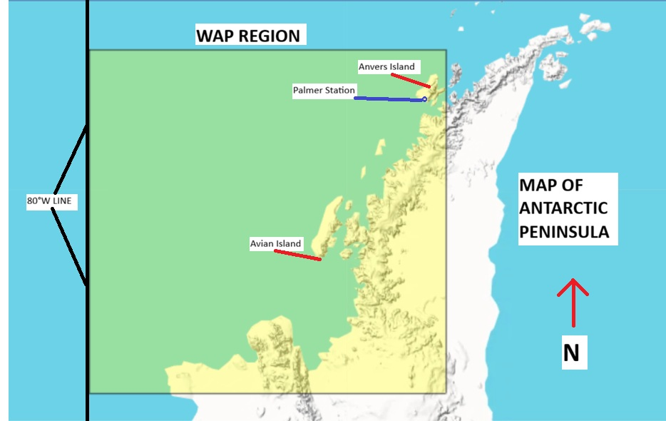

```{r setup, include=FALSE}
knitr::opts_chunk$set(echo = TRUE)
options(scipen = 999)
source("00_requirements.R")
```

## Data Description Section for Report

Investigating this question first requires a baseline understanding of how much air and ocean temperatures have changed on average in the Antarctic, due to increasing greenhouse gas concentrations in the atmosphere. It also requires an understanding of historical and current sea ice concentrations, sea ice area, and surveying several Antarctic sites to determine whether the effects of climate change are likely widespread or localized on the continent. The data chosen to consider these factors is taken from an NSF LTER (Long Term Ecological Research) site located on Anvers Island, directly off the western coast of the mainland Antarctic Peninsula, known as Palmer Station Antarctica LTER. Scientists at this site have been collecting weather data and sea ice changes for more than 40 years throughout the Western Antarctic Peninsular region, and per NSF requirements, all data collected must be routinely updated and published online freely through the Environmental Data Initiative (EDI) portal. Only an account with EDI is required to examine Palmer Station's data set information, collection information, and download the ".csv" files of various data tables. The citations and links to the data sets used for this preliminary report are included below, as all come from Palmer Station's EDI portal site:

1.  Palmer Station Antarctica LTER and S. Stammerjohn. 2024. Average monthly sea ice coverage for various PAL LTER sub-regions West of the Antarctic Peninsula derived from passive microwave satellite data, 1978 - June 2024. ver 9. Environmental Data Initiative. <https://doi.org/10.6073/pasta/ffbd9858508624cb8bf2b7bd0eca3e0c> (Accessed 2026-10-02).
2.  Palmer Station Antarctica LTER. 2024. Monthly weather averages for Palmer Station, Antarctica (1974-2024) ver 10. Environmental Data Initiative. <https://doi.org/10.6073/pasta/499f9fe0ac882f41c7b92e465a31291c> (Accessed 2026-10-02).

For the purposes of this preliminary analysis, this study will first consider the variables (from Monthly_Weather_Clean.csv) of monthly date tied with that month's mean temperature (°C) and mean sea surface temperature (°C) for every month from 1979 to 2023, or in some visualizations from late 1978 to early 2024. This leaves 540 total monthly weather observations from Palmer Station itself, from Jan 1979 to Dec 2023, or in some visualizations, 564 observations that include 12 extra months of data from Jan 1978 to Dec 2024, despite only late months in 1978 and early months in 2024 having data. In terms of the other two data sets (SeaIceArea_Clean.csv & SeaIceConc_Clean.csv) the variables this study considers is the year/monthly sea ice area (km²) and mean sea ice concentration (%) for the entire studied West Antarctic Peninsula region (WAP), Anvers and Avian Islands regions off the coast of the WAP, and (**JACK'S GRAPHS HAVE NO LABEL)**. The WAP region below includes 540 area values for 540 months between January 1979 to December 2023, with the Anvers, Avian, and **JACK REGION** Islands including 564 observations per region to include 1978 and 2024. The map below includes the regions examined in this preliminary analysis, and what the study considers the entire WAP region where sea ice area of this region was measured. The LTER station itself and other small island are also included.

{width="660"}

Figure 1: Map of Antarctic Peninsula, with Western Antarctic Peninsula highlighted in yellow.

The data set was prepared before being put into the repository by first replacing all of the -999 spaces with NA spaces, and changing the column names to shorter names with underscores instead of spaces, all being done in the .csv Excel files in order to be more friendly to R when loaded in. The names of the .csv files were also changed to show they were cleaned for R subsetting. Data was further cleaned for analysis by combining the year and month columns of SeaIceArea_Clean.csv and SeaIceConc_Clean.csv each into a single "Date" column like the weather data has (m/d/y), which allowed for a proper date column to be formatted and further allowed a subset by date to occur. Once the chosen dates were properly formatted and isolated, the desired regions and variables of those regions were isolated further. This was done in order to determine the visual relationships between a region's chosen variables, Palmer Station's weather data, or against time itself; each relationship is explained under each graph. The following code chunk is included to view the basic summaries of all variables considered in this analysis.

```{r, echo = TRUE}
##First, the cleaned .csv files are read into the global environment:
weather <- read.csv("Monthly_Weather_Clean.csv")
seaicearea <- read.csv("SeaIceArea_Clean.csv")
seaiceconc <- read.csv("SeaIceConc_Clean.csv")

##Practice code for making the visualizations/obs. tables for this section:
##Air temperature 
summary(weather$Mean_Temperature_C)
length(weather$Mean_Temperature_C)

##Mean Sea Surface Temperature Summary (in °C) and # of Obs. at Palmer Station, Antarctica:
summary(weather$Mean_Sea_Surface_Temperature_C)
length(weather$Mean_Sea_Surface_Temperature_C)

##Sea Ice Area Data Summary and # of Obs. For Total WAP Region, in km²:

for_sum <- seaicearea[seaicearea$Subregion == "WAP", ]
summary(for_sum$Sea_ice_area)
length(for_sum$Sea_ice_area)

##Sea Ice Concentration Summary and # of Obs. for both Anv and Avi Islands 

another_sum <- seaiceconc[seaiceconc$Subregion %in% c("Anv", "Avi"), ]
summary(another_sum$Mean_sea_ice_conc)
length(another_sum$Mean_sea_ice_conc)
```

## Making of WAP Sea Ice Area, Temps Plots, and Models:

```{r}
##First, the cleaned .csv files are read into the global environment:
weather <- read.csv("Monthly_Weather_Clean.csv")
seaicearea <- read.csv("SeaIceArea_Clean.csv")
seaiceconc <- read.csv("SeaIceConc_Clean.csv")

##Next, we need to determine what variables/observations we will work with:
summary(weather)
summary(seaicearea)
summary(seaiceconc)


##Then, we need to subset the data for mean temperatures for all years from 1979 to 2023, as these are the full years that we have data for (not parts of years):

weather_subset <- weather[, c("Date", "Mean_Temperature_C")]
View(weather_subset)

weather_subset$Date = as.Date(weather_subset$Date, format = "%m/%d/%Y")

weathergooddates <- weather_subset[
  weather_subset$Date >= as.Date("1979-01-01") &
    weather_subset$Date <= as.Date("2023-12-01"),]

View(weathergooddates)


##Now, we need to do the same thing with the Sea Ice Area data, getting 1979 to 2023 area values for sea ice area for a specific region, here WAP:

seaicearea$Date <- paste(seaicearea$Month, rep("01", length.out = 2256),
                         seaicearea$Year, sep = "-")

seaicearea <- seaicearea %>% dplyr::mutate(Date2 = lubridate::mdy(Date))

seaicearea_fixed <- seaicearea[seaicearea$Date2 >= as.Date("1979-01-01") & seaicearea$Date2 <= as.Date("2023-12-01"), ]

View(seaicearea_fixed)

seaicearea_WAP <- seaicearea_fixed[seaicearea_fixed$Subregion == "WAP", ]
View(seaicearea_WAP)

seaicearea_subsetWAP <- seaicearea_WAP[, c("Date2", "Sea_ice_area")]

View(seaicearea_subsetWAP)


##At this point, we end with the objects of weathergooddates and seaicearea_subsetWAP, both of which have 540 variables for all months of 1979 and 2023. Because the entries already line up in both datasets, such as the second entry in both datasets corresponding to February 1979, I can now graph the 540 temp values in weathergooddates versus the years, and the 540 area values in seaicearea_WAPdates versus years and do trendlines separately:


##Now we should be ready to plot!
plot(weathergooddates$Date, weathergooddates$Mean_Temperature_C,
     type = "l",
     xlab = "Monthly Measurements from 1979-2023",
     ylab = "Monthly Mean Temperatures at Palmer Station (°C)",
     main = "Monthly Mean Temperatures at Palmer Station, 1979-2023",
     col = "red")

abline(lm(weathergooddates$Mean_Temperature_C ~ weathergooddates$Date), col = "black", lwd = 2)

weathermodel <- lm(weathergooddates$Mean_Temperature_C ~ weathergooddates$Date)
summary(weathermodel)
weathermodel$fitted.values
weathermodel$coefficients
length(weathermodel$fitted.values)
weathermodel$fitted.values[526] - weathermodel$fitted.values[1]


## Looks like by using the linear model to fit a trendline to the temperature data over time, the slope of the trendline is positive, indicating temperatures are increasing on average over the time surveyed. The fitted.values seciton of the linear model gives the values of the trendline, with the difference between the first and last value of the model being positive 1.06°C, meaning that on average over the time surveyed, temperatures have increased by 1.06°C. 


##------------------------------------------------------


plot(seaicearea_subsetWAP$Date2, seaicearea_subsetWAP$Sea_ice_area,
     type = "l",
     xlab = "Monthly Measurements from 1979-2023",
     ylab = "Monthly Sea Ice Area for WAP Region (km²)",
     main = "Monthly Sea Ice Area for WAP Region, 1979-2023",
     col = "blue")

abline(lm(seaicearea_subsetWAP$Sea_ice_area ~ seaicearea_subsetWAP$Date2), col = "black", lwd = 2)

WAPareamodel <- lm(seaicearea_subsetWAP$Sea_ice_area ~ seaicearea_subsetWAP$Date2)
summary(WAPareamodel)

WAPareamodel$coefficients
WAPareamodel$fitted.values
length(WAPareamodel$fitted.values)
WAPareamodel$fitted.values[538] - WAPareamodel$fitted.values[1]


##Here using the same approach of a linear model, it appears that the slope of the trend line is -4.812, indicating a negative relationship between time and the amount of sea ice in the WAP region. Furthermore, by subracting the last and first value of the trendline, we can see the average amount of sea ice area has decreased by -78,942.7 km² over the years surveyed. 


#-----------------------ANALYSIS OF ABOVE TRENDS (11/28)-----------------------


##I would like to start by including windspeed and other climate variables from the weather dataset in my multiple linear regresssion. However, many climate variables were not recorded (like wind, precipitaiton, etc.) until a few months into 1989. This will take off ~10 years of air temp and sea ice data, but we'll see if it explain enough variation in the model to be worth it in the final model I will post to the final report. Simple seasonality:

weather$Date = as.Date(weather$Date, format = "%m/%d/%Y")

testc <- weather[weather$Date >= as.Date("1989-04-01") 
                & weather$Date <= as.Date("2023-12-01"), ]

testarea <- seaicearea_fixed[seaicearea_fixed$Date2
            >= as.Date("1989-04-01") & seaicearea_fixed$Date2 <= as.Date("2023-12-01"), ]
testarea2 <- testarea[testarea$Subregion == "WAP", c("Date2", "Sea_ice_area")]
View(testarea2)

JoinedTest <- left_join(testc, testarea2 %>% rename("Date" = "Date2"), 
                        by = "Date") %>%
  mutate(
    month_num  = month(Date),
    sun_presence = ifelse(month_num %in% c(4,5,6,7,8,9), 0, 1))

View(JoinedTest)


TestModel <- lm(JoinedTest$Sea_ice_area ~ JoinedTest$Mean_Temperature_C)
summary(TestModel)

 
##In this TestModel, it appears that mean air temperature alone explains aroud 68% of the variance in sea ice area, with an extremely low p-value, indicating significant relationship between the two and air temp explains over half the variation observed in sea ice over the 35 years observed. Further model building below, multiple linear regression to determine what variables are affecting sea ice area changes, with only variables with a low p-value and at least more than 5% of the variation explained:


TestModelMulti <- lm(JoinedTest$Sea_ice_area ~ JoinedTest$sun_presence 
                     + JoinedTest$Mean_Sea_Surface_Temperature_C
                     + JoinedTest$Mean_Temperature_C
                     + JoinedTest$Mean_Windspeed_knots
                     + JoinedTest$Mean_Precipitation_mm)

summary(TestModelMulti)


##WHAT THE MODEL AND SWITCHING OUT SEVERAL VARIALBLES TELLS ME:
#After attemping several combinations in the linear model with seasonality, sea surface temp, air temp, mean precipitation, and windspeed, it appears that mean precipitation and windspeed are significant predictors in terms of the low p-value, however in concert with the other predictors, explains 1% or less of the variation in the data. On the other hand, sea surface temp paired with seasonality explains around 60% of the variation in the data and are significant predictors. Furthermore, around 75% of the variation is explained by air temp and seasonality alone, and when adding ocean temperatures, this only increases the explanation in the variation by 3%. With all this in mind, it seems air temperature and seasonality are the strongest two predictors of sea ice variation in the region, and so cutting off 10 years of data to accomodate further climate variables for only 1-3% increase in variation does not seem worth it to me. Will keep normal 1979 to 2023 air temp and sea ice area data with seasonlality, and will not include other climate variables. Sea surface temperature explains only 3% more variation when paired with air temps and seasonality, and so likely due to high correlation between the two variables, will not be included in the model since air temp is a stronger predictor overall (75% already explained with air/seasonality alone). Seasonality accounts for about a 7% increase in explanation so will keep.


##End of determining significant variables, redoing graph analysis-----------------------------------

## Start by left Join in R to combine the linear models made by graphs, since only will consider a more detailed seasonality variable instead of sun presence (full seasons) and air temp which was already subsetted:

## First simple linear regression model with no time analysis:

JoinedWAPC <- left_join(seaicearea_subsetWAP %>% rename("Date" = "Date2"),
          weathergooddates,
          by = "Date") %>%
  mutate(
    month_num  = month(Date),
    season = ifelse(month_num %in% c(12, 1, 2), "Summer",
             ifelse(month_num %in% c(3, 4, 5), "Fall",
             ifelse(month_num %in% c(6, 7, 8), "Winter",
             ifelse(month_num %in% c(9, 10, 11), "Spring", NA)))))
    

JoinedWAPC$season <- as.factor(JoinedWAPC$season)


#Seasons of the Southern Hemisphere included, important to note that during Fall/Winter, nighttime can be up to 24 hours a day for up to several weeks. Summer/Spring, daytime hours can be up to 24 hours in a single day for up to several weeks. 

##JoinedWAPC includes seasonality, sea ice area and corresponding temperature for 540 months between 1979 and 2023, now to investigate model:
JoinedModel1 <- lm(JoinedWAPC$Sea_ice_area ~ JoinedWAPC$Mean_Temperature_C)

summary(JoinedModel1)

#Muliple R-squared: 0.6622 amount of variation explained by air temp alone.


##Multiple linear regression model with adding time:
JoinedModel2 <- lm(JoinedWAPC$Sea_ice_area ~ JoinedWAPC$Mean_Temperature_C +
                     JoinedWAPC$Date)

summary(JoinedModel2)


#Adjusted R-squared: 0.6662
#Square rooting the adjusted R square value gives the linear regressions correlation between the variables and the y variable?

##FINAL MULTIPLE LINEAR REGRESSION MODEL WITH GRAPH:
##Joined Model 3 considering actual seasonality in Antarica for surveyed time:
JoinedModel3 <- lm(JoinedWAPC$Sea_ice_area ~ JoinedWAPC$season
                   + JoinedWAPC$Mean_Temperature_C)

summary(JoinedModel3)


par(mfrow = c(2, 2))
plot(JoinedModel3)

#Final Plot showcasing the relationships discussed in JoinedModel3
ggplot(data = JoinedWAPC, aes(x = Mean_Temperature_C, y = Sea_ice_area,
      color = season)) +
  geom_point(size = 2) +
  scale_color_manual(values = c(
    "Spring" = "green",
    "Summer" = "gold",
    "Fall" = "firebrick",
    "Winter" = "blue")) +
  labs(
    title = "WAP Sea Ice Area vs. Mean Air Temperature, With Seasonality (1979 - 2023)",
    x = "Monthly Mean Air Temperature (°C) ",
    y = "Monthly Sea Ice Area (km²)",
    color = "Season") +
  theme_classic()

##By increasing the specificity of the season instead of a simple 1-0 variable following the sun's presence, seasonality alone predicts almost 59% of the variance, while temperature alone predicts 66% of the variance. Together these variables account for 82% of the variation in sea ice changes! Residual plots indicate mostly linear relationship, not perfect.

##Correlation between variables appears to be 90.8%, and according to previous work, other climate variables included in our datasets do not account for more than a few percentage points beyond this, and so is a limit on the data we can work with. 82.5% highest explanation of variance achieved with more years included than the previous test models.


##End to Linear Model tests, other important correlational tests:
------------------------------------------------------------------

##Attempt to use a Spearman correlation test between the variables:


cor.test(JoinedWAPC$Sea_ice_area, JoinedWAPC$Mean_Temperature_C, 
         method = "spearman", exact = FALSE)

#Using the Spearman correlation test above, we establish that the p-value is less than 2.2e-16, so there is strong significance between the predictor and response variable. The rho, or the Spearman correlation coefficient, shows a -0.76, meaning that these variables share a strongly negative correlation as the value is negative and very close to negative 1. No causation proven, only strong support for correlation between the values, and so temperature is a strong statistical predictor of sea ice variability, suggesting that temperature varitability is an important factor when considering changes in sea ice area. 


plot(vif(JoinedModel3))

#Adjusted GVIF values are 1.18 and 1.64, indicating multicollinearity is not a concern for the model, as the two predictor variables do not appear highly correlated with each other and so the linear model output should not be skewed.


#Look into ACF plots:

Acf(residuals(JoinedModel3),
    lag.max = 60, 
    main = "ACF of Sea Ice Linear Regression Residuals",
    xaxt = "n")

axis(1, at = seq(0, 60, by = 2))

##Autocorrelation is present in residuals; the model does not account for strong correlation between consecutive months or annual patterns, hence the positive lag spikes at 1 lag and consistently every 12 lags (12, 24, 36, etc.) The residuals do not appear to be independent, and so the data from the JoinedModel3 linear regression model may be inaccurate to the true p-values and other correlational values given in the summary of the linear model. Time specific patterns are not fully addressed by model. This is a limitation of the model that this study is using. 
```

## Analysis Section of Final Report with New Models:
